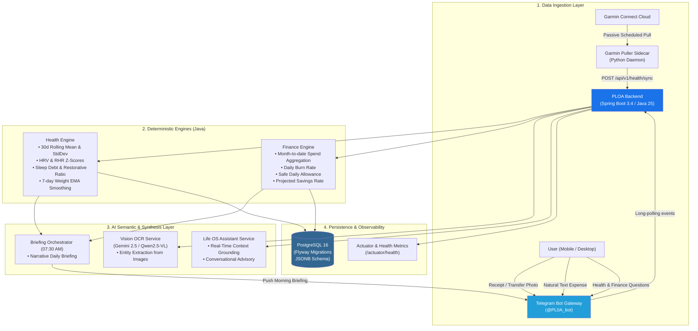

# Personal Life OS Agent (PLOA)

[](https://openjdk.org/projects/jdk/25/)
[](https://spring.io/projects/spring-boot)
[](https://www.postgresql.org/)
[](https://opensource.org/licenses/MIT)

A high-integrity, private, self-hosted personal life operating system tracking **physical health & recovery** (Garmin) and **personal finances** (Telegram Bot + Vision OCR).

Unlike superficial AI wrappers, PLOA enforces a strict separation between **deterministic mathematical modeling** and **generative language tasks**:
- **Deterministic Java Engines**: All metric calculations (HRV/RHR rolling 30-day Z-scores, sleep debt, 7-day Exponential Moving Average weight smoothing, daily burn rate, and safe daily allowance) execute strictly in Java. The LLM is **never** permitted to calculate or alter math scores.
- **AI Semantic & Thought Partner**: Generative models (Gemini / Ollama) act exclusively as entity extractors (Vision OCR for receipts/transfers), intelligent conversational advisors, and morning briefing synthesizers.

---

## 🏛️ System Architecture



---

## 🌟 Key Features & Documentation

> Detailed architecture, formula, and implementation guides are available in the [`docs/`](docs/) directory:
> - [🏥 Health & Biometrics Tracking](docs/health.md)
> - [💰 Personal Finance Ledger & Burn Rate](docs/finance.md)
> - [🤖 Life OS AI Assistant](docs/assistance.md)
> - [👁️ Vision OCR & Multimodal Ingestion](docs/ai-ocr.md)
> - [📱 Telegram Bot Gateway](docs/telebot.md)

### 1. 🏥 Passive Physical Health & Recovery Tracking
- **Automated Garmin Ingestion**: The `ploa-garmin-puller` sidecar connects to Garmin Connect using persistent session tokens (preventing rate limits).
- **Real-Time & Daytime Pulse**: Ingests biometrics every 15 minutes during active hours (06:00 - 23:00) to keep live metrics up-to-date, with early-morning finalization for yesterday's totals.
- **Comprehensive Biometrics Suite**: Ingests and tracks the full spectrum of Garmin telemetry:
  - **Body Battery & Stress**: Current, highest, lowest, charged, drained, average stress, maximum stress, and stress qualifiers.
  - **Cardiovascular & Respiratory**: Resting Heart Rate (RHR), Min/Max Heart Rate, overnight HRV (rMSSD), average SpO2, and respiration rate.
  - **Sleep Architecture**: Sleep Score, total duration, sleep debt against personal targets, and restorative sleep ratio (Deep + REM).
  - **Activity & Energy**: Steps, distance (meters), active vs. total caloric burn, and active minutes (moderate & vigorous).
  - **Raw Telemetry**: Persisted in PostgreSQL as `raw_data_jsonb` for future-proof analytical queries and ad-hoc AI exploration.
- **HRV & Resting HR Z-Scores**: Evaluates sympathetic vs parasympathetic nervous system recovery against a rolling 30-day baseline ($\mu \pm \sigma$). Classifies recovery as `PRIME`, `NORMAL`, `FATIGUED`, or `STRESSED`.
- **7-day EMA Weight Smoothing**: Filters out daily water retention fluctuations using an Exponential Moving Average ($\alpha = 2/(N+1)$) towards your target goal.

### 2. 💰 Frictionless Personal Finance Ledger
- **Vision OCR Extraction**: Send a bank transfer confirmation screenshot, paper receipt, or online shopping checkout directly to the Telegram bot. Gemini Vision extracts amount, merchant, category, and line items.
- **Interactive Inline Keyboard**: Every captured transaction is held in a draft state with interactive buttons:
  - `[✅ Confirm]`: Commits the transaction to PostgreSQL.
  - `[🔄 Toggle Type]`: Switches between Fixed and Discretionary spending.
  - `[🗑️ Delete]`: Discards the entry.
- **Deterministic Burn Rate Engine**: Dynamically calculates average daily burn rate, remaining monthly budget, and safe daily allowance based on elapsed vs remaining days.

### 3. 🤖 Life OS AI Assistant & Intelligent Chat Router
- **Context-Aware Conversational Assistant**: Ask the bot or REST API questions like:
  - *"Should I play high-intensity sports today?"*
  - *"How was my sleep recovery last night?"*
  - *"How much budget do I have left for the rest of the month?"*
- **Automatic Intent Classification**:
  - Expense inputs (`50k coffee`, `120k groceries`) $\rightarrow$ routed to the structured expense logger.
  - General questions or conversation $\rightarrow$ routed to the AI Assistant, which answers based on your actual deterministic numbers.
- **Daily Executive Briefings & Summaries**:
  - **Morning Briefing (07:30 AM)**: Synthesizes physical readiness, sleep debt, body composition trend, and financial pacing into a motivating, 200-word executive briefing pushed directly to Telegram.
  - **Evening Summary (09:30 PM / 21:30)**: Complete end-of-day recap synthesizing completed steps, active/total caloric burn, body battery drain, stress dynamics, day's expenses, and actionable wind-down/sleep recommendations.

---

## 🛠️ Tech Stack

| Layer | Component | Specification |
|---|---|---|
| **Language & Runtime** | Java 25 | Eclipse Temurin 25 JRE (compiled with `--release 21` for Spring Boot compatibility) |
| **Framework** | Spring Boot 3.4.0 | Spring AI 1.0.0, Spring Security, Spring Data JPA, Actuator |
| **Database** | PostgreSQL 16 | Alpine image, Flyway migrations, native JSONB support |
| **Health Ingestion** | Python 3.12 Sidecar | `garminconnect>=0.3.19`, `garth>=0.8.0`, `schedule`, `requests` |
| **Chat Gateway** | Telegram Bot API | `telegrambots-springboot-longpolling-starter:7.10.0`, OkHttp client |
| **Vision & LLM** | Google Gemini / Ollama | Gemini Flash (Cloud) or local Qwen2.5-VL / Llama 3.2 (Local) |
| **Containerization** | Docker Compose | Multi-container stack (`ploa-postgres`, `ploa-backend`, `ploa-garmin-puller`) |

---

## 📂 Repository Layout

```
PLOA/
├── docker-compose.yml              # PostgreSQL + Backend + Garmin Sidecar
├── .env.example                    # Environment configuration template
├── backend/                        # Spring Boot 3.4 (Java 25)
│   ├── Dockerfile                  # Lightweight production container
│   ├── pom.xml                     # Maven dependencies & Spring AI BOM
│   └── src/main/java/com/ploa/
│       ├── PloaApplication.java
│       ├── config/                 # SecurityConfig, PloaProperties
│       ├── health/                 # Health Domain
│       │   ├── api/                # HealthController (/sync, /readiness, /weight, /sleep)
│       │   ├── engine/             # ReadinessEngine, WeightEmaEngine, SleepEngine
│       │   ├── model/              # HealthMetric entity
│       │   ├── repository/         # HealthMetricRepository
│       │   └── service/            # HealthService
│       ├── finance/                # Finance Domain
│       │   ├── api/                # FinanceController (/burn-rate, /transactions, /ocr)
│       │   ├── engine/             # BurnRateEngine
│       │   ├── model/              # Transaction entity, SpendType enum
│       │   ├── repository/         # TransactionRepository
│       │   └── service/            # FinanceService
│       ├── assistant/              # Life OS AI Assistant Domain
│       │   ├── api/                # ChatController (/chat), MemoryController (/memory)
│       │   ├── dto/                # ChatRequest, ChatResponse
│       │   ├── memory/             # ChatMessage, UserMemory entities & MemoryService
│       │   ├── tools/              # AssistantTools (Atomic SRP Tool Matrix)
│       │   └── AssistantService.java # Two-Stage Selective Tool Planner
│       ├── briefing/               # Morning & Evening Briefing Domain
│       │   ├── api/                # BriefingController (/preview, /trigger, /evening/*)
│       │   └── BriefingOrchestrator.java # 07:30 Morning & 21:30 Evening Schedulers
│       ├── bot/                    # Telegram Bot Gateway
│       │   ├── TelegramBotHandler.java
│       │   ├── BotMessageFactory.java
│       │   └── TelegramFormatter.java # Safe Markdown to HTML Formatter
│       └── ai/                     # Vision OCR Service (Gemini / Ollama)
└── garmin-puller/                  # Python sidecar
    ├── Dockerfile
    ├── puller.py                   # Automated daily pull & token cache
    └── requirements.txt
```

---

## ⚡ Quick Start

### 1. Configure Environment
Clone the repository and copy the sample configuration:
```bash
git clone https://github.com/nhthinh-axonivy/Personal-Life-OS-Agent.git
cd Personal-Life-OS-Agent
cp .env.example .env
```

Edit `.env` with your credentials:
```env
# Database
POSTGRES_DB=ploa
POSTGRES_USER=ploa
POSTGRES_PASSWORD=your_secure_db_password

# API Security
API_SECRET_KEY=your_secret_api_key

# Telegram Bot
TELEGRAM_BOT_TOKEN=your_telegram_bot_token
TELEGRAM_BOT_USERNAME=your_bot_username
TELEGRAM_ALLOWED_CHAT_IDS=your_telegram_user_id

# AI Providers
GOOGLE_AI_API_KEY=your_gemini_api_key
GEMINI_MODEL=gemini-2.5-flash

# Garmin Connect
GARMIN_EMAIL=your_garmin_email
GARMIN_PASSWORD=your_garmin_password
GARMIN_PULL_TIME=06:30
```

### 2. Build & Launch Containers
```bash
# Package the backend JAR
mvn -f backend/pom.xml package -DskipTests -B

# Launch the full stack
docker compose up -d --build
```

Verify services are up and healthy:
```bash
docker compose ps
```

---

## 📡 REST API Reference

All protected endpoints accept authentication through any of the following methods:
1. Header: `X-API-Key: <your_secret_key>`
2. Header: `Authorization: Bearer <your_secret_key>`
3. Query Parameter: `?apiKey=<your_secret_key>` *(ideal for browser testing)*

### 1. Health & Recovery
| Method | Endpoint | Description | Query / Body |
|---|---|---|---|
| **GET** | `/api/v1/health/daily` | Retrieve biometrics for a specific date (today, yesterday, or YYYY-MM-DD). | `?date=today` or `?date=yesterday` or `?date=2026-10-18` |
| **GET** | `/api/v1/health/today` | Retrieve comprehensive live biometrics for today (Body Battery, Stress, Calories, Steps, etc.). | *(None)* |
| **POST** | `/api/v1/health/pull` | Trigger immediate on-demand synchronization from the Garmin sidecar. | *(None)* |
| **POST** | `/api/v1/health/sync` | Ingest daily physiological metrics (idempotent upsert). | `{"date":"2026-10-19", "hrvRmssd":50, "rhr":53, ...}` |
| **GET** | `/api/v1/health/readiness` | Compute 30-day rolling Z-scores, sleep debt, and recovery state. | `?date=today` or `?date=2026-10-19` |
| **GET** | `/api/v1/health/weight` | Calculate 7-day EMA weight trend and delta to goal. | *(None)* |
| **GET** | `/api/v1/health/sleep` | Retrieve sleep breakdown (deep, light, REM) and 7-day weekly trend. | *(None)* |

### 2. Financial Ledger
| Method | Endpoint | Description | Query / Body |
|---|---|---|---|
| **GET** | `/api/v1/finance/burn-rate` | Retrieve month-to-date burn rate, remaining budget, and daily allowance. | *(None)* |
| **GET** | `/api/v1/finance/transactions` | List confirmed and draft transactions for the current month. | `?limit=30` |
| **POST** | `/api/v1/finance/ocr` | Upload and extract structured receipt data from an image file. | Multipart form-data `file=@receipt.jpg` |
| **GET** | `/api/v1/finance/ocr/metrics` | Retrieve OCR stability KPIs (acceptance rate, edit rate, discard rate, confidence). | *(None)* |

### 3. AI Assistant & Memory
| Method | Endpoint | Description | Query / Body |
|---|---|---|---|
| **POST** | `/api/v1/chat` | Conversational query with multi-turn session tracking & selective tools. | `{"message": "How many km did I run yesterday?", "chatId": "session-1"}` |
| **GET** | `/api/v1/chat` | Browser-accessible chat query. | `?q=how+is+my+recovery&chatId=browser-1` |
| **GET** | `/api/v1/memory` | List all stored long-term user preferences & goals. | `?category=FITNESS` (optional) |
| **POST** | `/api/v1/memory` | Save or update a persistent user habit/goal/preference. | `{"category": "FITNESS", "key": "goal", "value": "21km"}` |
| **DELETE** | `/api/v1/memory/{id}` | Delete a stored user memory by UUID. | *(None)* |
| **DELETE** | `/api/v1/memory/history` | Clear conversation history for a given session/chat ID. | `?chatId=session-1` |

### 4. Daily Briefings & Summaries
| Method | Endpoint | Description | Query / Body |
|---|---|---|---|
| **GET** | `/api/v1/briefing/preview` | Preview today's AI-generated morning briefing text (07:30). | *(None)* |
| **POST** | `/api/v1/briefing/trigger` | Manually generate and deliver the morning briefing to Telegram. | *(None)* |
| **GET** | `/api/v1/briefing/evening/preview` | Preview today's AI-generated evening summary text (21:30). | *(None)* |
| **POST** | `/api/v1/briefing/evening/trigger` | Manually generate and deliver the evening summary to Telegram. | *(None)* |

### 5. Observability
| Method | Endpoint | Description |
|---|---|---|
| **GET** | `/actuator/health` | Liveness & database connectivity probe (`{"status":"UP"}`). |
| **GET** | `/actuator/info` | Application metadata. |
| **GET** | `/actuator/metrics` | JVM, HikariCP connection pool, and thread metrics. |

---

## 📱 Telegram Bot Commands

| Command | Action |
|---|---|
| `/health` | View today's readiness level (`PRIME`/`NORMAL`/`STRESSED`), HRV/RHR Z-score, sleep debt, and 7-day weight EMA. |
| `/sync` | Trigger instant Garmin biometric sync and display live Body Battery, Stress, Steps, Calories, and HR extremes. |
| `/finance` | View month-to-date spending pace, remaining budget, and safe daily allowance. |
| `/briefing` | On-demand trigger to generate and deliver the morning briefing to your chat (07:30). |
| `/evening` | On-demand trigger to generate and deliver the complete daily evening summary (21:30). |
| `/new` | Clear short-term chat memory to start a fresh conversation session. |
| `/help` | Display command cheat-sheet and quick-start instructions. |
| **Photo / Receipt** | Automatically triggers Vision OCR entity extraction and draft creation. |
| **Text Expense** | E.g. `50k coffee`, `120k groceries` $\rightarrow$ parses into structured ledger. |
| **Chat / Question** | E.g. *"Can I do heavy lifting today?"* $\rightarrow$ routes to AI Assistant. |

---

## 🔧 CLI & Utility Flags

### Garmin Historical Backfill & On-Demand Sync
You can pull and sync past Garmin data at any time:
```bash
# Backfill the past 30 days
docker exec ploa-garmin-puller python puller.py --backfill 30

# Pull a specific date
docker exec ploa-garmin-puller python puller.py --date 2026-10-15

# Trigger an immediate sync for yesterday and today via CLI
docker exec ploa-garmin-puller python puller.py --now

# Trigger an immediate sync via internal sidecar HTTP endpoint (:8081)
curl -X POST http://localhost:8081/pull
```

---

## 📄 License
This project is licensed under the [MIT License](LICENSE).
