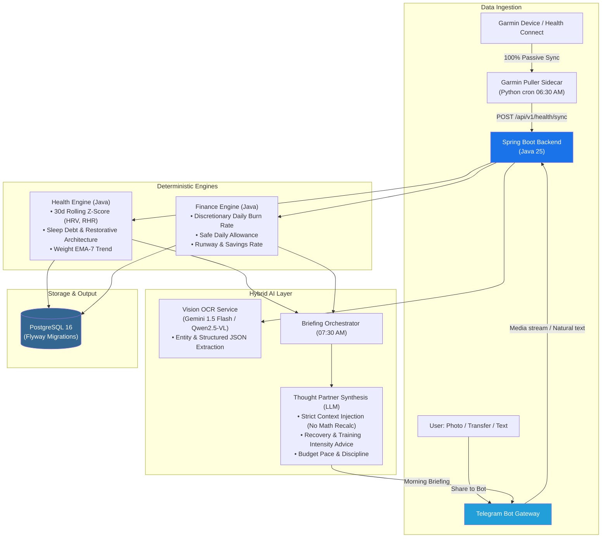

# Personal Life OS Agent (PLOA)

[](https://openjdk.org/projects/jdk/25/)
[](https://spring.io/projects/spring-boot)
[](https://www.postgresql.org/)
[](https://opensource.org/licenses/MIT)

A high-integrity, private, self-hosted personal assistant designed to track **physical health/recovery** and **personal finances**.

Unlike superficial AI wrappers, PLOA enforces a strict separation between **deterministic mathematical modeling** and **generative language tasks**. The LLM never computes numerical scores — it strictly acts as a semantic extractor (Vision OCR) and thought partner synthesizing pre-calculated metrics into daily briefings.

---

## 🏛️ Architecture & Philosophy



### Core Principles
1. **Zero Manual Effort (Passive-First)**: Health data is ingested 100% passively from Garmin / Health Connect without user friction. Financial data is logged via instant screenshot sharing (VietQR bank transfers, Shopee orders, physical receipts) or 2-second quick notes (`50k cafe`, `120k cầu lông`).
2. **Deterministic Metric Engine**: All baseline stats, statistical smoothing (EMA), Z-score evaluations, and financial burn rates execute exclusively in deterministic Java services.
3. **LLM as Semantic & Thought Partner**: Generative models are restricted to structured JSON extraction and narrative synthesis.
4. **Hybrid Cloud / Local AI**: Seamlessly switches between Cloud APIs (Gemini 1.5 Flash) during travel and local Ollama models (Qwen2.5-VL-7B / Llama 3.2 on RTX 5070 Ti) at home.

---

## 🚀 Tech Stack

| Layer | Component | Specification |
|---|---|---|
| **Core Backend** | Java 25 | Spring Boot 3.4.x, Spring AI, Hibernate/JPA |
| **Database** | PostgreSQL 16 | Flyway migrations, JSONB support |
| **Health Sidecar** | Python 3.12 | `python-garminconnect`, `schedule`, `requests` |
| **Bot Gateway** | Telegram Bot API | Long-polling mode, inline interactive callbacks |
| **Cloud Vision / LLM** | Gemini 1.5 Flash | Google AI API via OpenAI-compatible Spring AI endpoint |
| **Local Vision / LLM** | Ollama | Qwen2.5-VL-7B & Llama 3.2 on RTX 5070 Ti (WSL2) |
| **Containerization** | Docker Compose | Multi-stage Dockerfiles with Temurin 25 |

---

## 📂 Project Structure

```
PLOA/
├── docker-compose.yml          # Postgres + Backend + Garmin Sidecar
├── .env.example                # Environment variables template
├── .gitignore
├── backend/                    # Spring Boot 3.4 (Java 25)
│   ├── Dockerfile
│   ├── pom.xml
│   └── src/
│       ├── main/
│       │   ├── java/com/ploa/
│       │   │   ├── PloaApplication.java
│       │   │   ├── config/             # PloaProperties, SecurityConfig (API Key)
│       │   │   ├── health/             # Domain 1: Passive Health
│       │   │   │   ├── api/            # /api/v1/health/sync, /readiness, /weight
│       │   │   │   ├── engine/         # ReadinessEngine (Z-score), WeightEmaEngine
│       │   │   │   ├── model/          # HealthMetric entity
│       │   │   │   ├── repository/     # HealthMetricRepository
│       │   │   │   └── service/        # HealthService
│       │   │   ├── finance/            # Domain 2: Financial Cashflow
│       │   │   │   ├── engine/         # BurnRateEngine, BurnRateResult
│       │   │   │   ├── model/          # Transaction entity, SpendType enum
│       │   │   │   ├── repository/     # TransactionRepository
│       │   │   │   └── service/        # FinanceService
│       │   │   ├── ai/                 # VisionOcrService (Gemini / Ollama)
│       │   │   ├── bot/                # TelegramBotHandler & BotMessageFactory
│       │   │   └── briefing/           # BriefingOrchestrator (07:30 AM cron)
│       │   └── resources/
│       │       ├── application.yml
│       │       ├── application-cloud.yml
│       │       ├── application-local.yml
│       │       └── db/migration/
│       │           └── V1__init_schema.sql
│       └── test/
└── garmin-puller/              # Python cron sidecar
    ├── Dockerfile
    ├── puller.py               # Auto pulls sleep, HRV, RHR, steps, weight
    └── requirements.txt
```

---

## ⚡ Quick Start

### 1. Configure Environment
```bash
cp .env.example .env
# Edit .env with your credentials (Postgres, Telegram token, Gemini API key, Garmin)
```

### 2. Run with Docker Compose
```bash
docker compose up -d
```

### 3. Local Development (Backend)
```bash
cd backend
mvn clean spring-boot:run
```

---

## 📡 API Endpoints

- **POST** `/api/v1/health/sync` — Ingest daily physiological JSON payload (secured via `X-API-Key`)
- **GET** `/api/v1/health/readiness?date=today` — Get deterministic HRV/RHR Z-scores and recovery state
- **GET** `/api/v1/health/weight` — Get 7-day EMA weight trend vs target (68.0 kg)
- **GET** `/actuator/health` — Application health check

---

## 💬 Telegram Bot Interaction

- **Share image**: Send screenshot of VietQR transfer, Shopee order, or physical receipt -> Vision OCR extracts transaction -> Inline confirmation card.
- **Natural text**: Type `50k cafe` or `120k cầu lông` -> auto parses into ledger.
- **Commands**:
  - `/health` — Summary of HRV/RHR baseline and weight EMA trend.
  - `/finance` — MTD spend, daily burn rate, and category breakdown.
