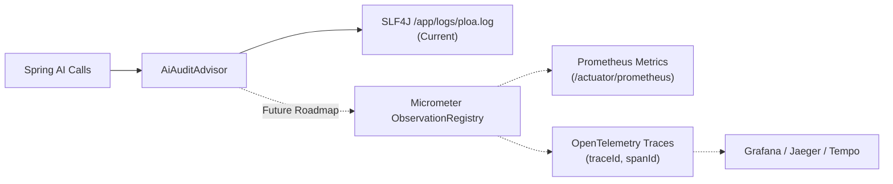

# 🔍 AI Audit & Model Observability

The AI Audit subsystem in PLOA provides **developer-focused observability** into all LLM calls across the application. It captures token consumption, request latency, prompt character footprints, and execution status without cluttering logs with non-developer pricing metrics.

---

## 🏗️ Architecture

```mermaid
flowchart TD
    subgraph Clients["Spring AI Services"]
        A["VisionOcrService\n(ocr_image, ocr_text, ocr_refine)"]
        B["AssistantService\n(assistant_planner, assistant_synthesis)"]
        C["BriefingOrchestrator\n(briefing_morning, briefing_evening)"]
    end

    subgraph Customizer["ChatClient Configuration"]
        CFG["AiAuditConfig\n(ChatClientCustomizer)"]
    end

    subgraph Interceptor["Audit Advisor Layer"]
        ADV["AiAuditAdvisor\n(implements CallAdvisor, StreamAdvisor)\n• Captures op param from context\n• Measures execution latency (ms)\n• Extracts Spring AI Usage metadata\n• Measures prompt length (chars)"]
    end

    subgraph Aggregator["Observability & Aggregation"]
        SVC["AiAuditService\n• In-memory circular buffer (max 500 records)\n• Cumulative token counters (in, out, total)\n• Latency tracking\n• Emits [AI-AUDIT] structured log\n• Emits [AI-AUDIT-SUMMARY] milestone log"]
    end

    subgraph Engine["External Model Provider"]
        M["Google Gemini API (Cloud) /\nOllama (Local Workstation)"]
    end

    A & B & C -->|chatClient.prompt().advisors(op)| CFG
    CFG --> ADV
    ADV -->|chain.nextCall(request)| M
    M -->|ChatClientResponse| ADV
    ADV -->|recordSuccess / recordFailure| SVC
```

---

## 📋 Log Formats & Semantic Tagging

### 1. Per-Request Audit Log (`[AI-AUDIT]`)
Every LLM call emits a structured, parseable log line at `INFO` level:

```text
[AI-AUDIT] op=assistant_synthesis model=gemini-3.5-flash-lite tokens: in=655 out=57 total=712 latency=1693ms chars=2361
[AI-AUDIT] op=assistant_planner model=gemini-3.5-flash-lite tokens: in=722 out=69 total=791 latency=772ms chars=2697
[AI-AUDIT] op=ocr_image model=gemini-1.5-flash tokens: in=385 out=60 total=445 latency=710ms chars=890
```

* **`op`**: The semantic operation context passed via `.advisors(a -> a.param("operation", "..."))`.
* **`model`**: Model identifier reported by the provider (`gemini-1.5-flash`, `gemini-3.5-flash-lite`, `llama3.2`, etc.).
* **`tokens: in=... out=... total=...`**: Prompt (input) tokens, completion (output) tokens, and total tokens.
* **`latency`**: End-to-end execution time in milliseconds.
* **`chars`**: Estimated character footprint of all input instructions.

### 2. Cumulative Milestone Log (`[AI-AUDIT-SUMMARY]`)
Every 25 requests, `AiAuditService` logs an aggregated health milestone:

```text
[AI-AUDIT-SUMMARY] Total calls: 25 | tokens: 18450 (in=16200, out=2250) | avg_latency: 520ms
```

### 3. Failure Log
If a call fails or is rate-limited:

```text
[AI-AUDIT] op=ocr_image model=gemini-1.5-flash FAILED latency=312ms chars=1420 error=429 Too Many Requests
```

---

## 🏷️ Standard Operation Tags

| Operation Tag | Triggering Class | Purpose |
| :--- | :--- | :--- |
| `assistant_planner` | `AssistantService` | Stage 1 selective tool planning & JSON routing. |
| `assistant_synthesis` | `AssistantService` | Stage 2 final conversational response generation. |
| `assistant_vision` | `AssistantService` | Multimodal chat and analysis on user-uploaded images (food, workouts, general). |
| `ocr_image` | `VisionOcrService` | Multimodal entity extraction from receipt or transfer images. |
| `ocr_text` | `VisionOcrService` | Fast natural language parsing of text expenses (`50k coffee`). |
| `ocr_refine` | `VisionOcrService` | User conversational corrections on pending transactions. |
| `briefing_morning` | `BriefingOrchestrator` | Daily 07:30 AM executive morning summary. |
| `briefing_evening` | `BriefingOrchestrator` | Daily 09:30 PM (21:30) evening recovery and spend recap. |

---

## ⚡ Model Call Optimizations

To reduce token consumption and latency, the following optimizations are baked into the pipeline:

### 1. Conversational Fast-Path Short-Circuit
* `AssistantService.shouldSkipToolPlanning(text)` automatically catches greetings, pleasantries, and small talk (`"hello"`, `"thanks"`, `"ok"`, `"who are you"`).
* Bypasses the tool planner LLM call completely, returning an empty tool plan immediately.
* **Savings**: Cuts **50% of LLM calls** on casual turns (~800 tokens and 1 roundtrip saved).

### 2. Streamlined Planner Prompt
* Replaced ~50 lines of defensive negative rules (*"NEVER save daily routines... NEVER save answers to questions..."*) with concise, positive trigger conditions.
* Cut planner prompt character count by **~50%** while improving model accuracy.

### 3. Compact Grounding Data
* Switched from pretty-printed JSON (`writerWithDefaultPrettyPrinter()`) to compact JSON (`writeValueAsString()`).
* Strips all indentation and newline whitespace tokens from retrieved database context (saving 30–40% of grounding tokens).

### 4. Sliding Context Window & Lean Behavioral Guidelines
* Bounded past conversation history to the last **4 immediate turns** (instead of unbounded turns), preventing prompt ballooning on long conversations.
* Condensed 9 verbose behavioral guidelines into 5 focused instructions, saving ~850 characters (~220 tokens) on every synthesis turn.

### 5. Automatic Receipt Image Pre-Processing (`ImageOptimizer`)
* Phone camera uploads (4032x3024, 3–10 MB) are automatically downsampled to **max 1280px** at 85% JPEG quality before encoding.
* Reduces image file size by ~60–80% and slashes vision tile patches from **16+ down to 2–4 tiles** (~1,500 vision tokens saved per receipt).

### 6. Lean Text Expense Prompt
* Quick text notes (`"50k coffee"`) use a dedicated 14-line prompt instead of the 58-line full receipt extraction prompt, saving **~75% of input tokens** per text note.

---

## 🔭 Future Observability Roadmap

The current architecture is intentionally structured to integrate with enterprise observability tools:



### 1. Micrometer & Prometheus Metrics
* Export counters and timers through `io.micrometer.core.instrument.MeterRegistry`:
  * `ai.requests.total{operation="...", model="...", status="..."}`
  * `ai.tokens.prompt{operation="...", model="..."}`
  * `ai.tokens.completion{operation="...", model="..."}`
  * `ai.latency.seconds{operation="...", model="..."}`
* Accessible via standard Spring Boot Actuator endpoint (`/actuator/prometheus`).

### 2. OpenTelemetry Tracing (`traceId` Propagation)
* Propagate distributed trace contexts from the Telegram update handler through `ChatClient` calls.
* Enables correlating a specific Telegram message ID with its downstream LLM planner span, tool database queries, and synthesis span in Jaeger or Grafana Tempo.

### 3. Token Spike & Anomaly Detection
* Emit warning logs or Telegram admin alerts when a single prompt exceeds a configurable token threshold (e.g., > 4,000 tokens) or when latency exceeds 5 seconds.
