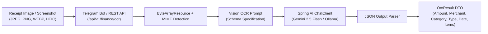

# 👁️ Vision OCR & Entity Extraction

The AI OCR subsystem in PLOA turns unstructured documents (receipt photos, banking transfer screenshots, e-commerce checkouts) and natural text into structured financial transactions.

---

## 🏗️ Architecture & Multimodal Pipeline



---

## 🎯 Supported Ingestion Modalities

1. **Telegram Photo Upload**: Compressed image uploaded from mobile/desktop photo gallery.
2. **Telegram Document Photo**: Uncompressed image file sent as an attachment.
3. **Natural Text Description**: Quick text notes like `50k coffee highlands`, `120k groceries winmart`, `200k electricity bill`.
4. **Multipart REST API (`POST /api/v1/finance/ocr`)**: Direct file upload from curl, Postman, or external automations.

---

## 📄 Extracted Data Schema (`OcrResult`)

The Vision model strictly adheres to the following structured entity schema:

```json
{
  "amount": 55000,
  "currency": "VND",
  "merchant": "Highlands Coffee",
  "category": "Food & Dining",
  "spendType": "DISCRETIONARY",
  "txDate": "2026-10-19",
  "note": "Iced milk coffee size L",
  "confidence": 0.95,
  "lineItems": [
    {
      "item": "Large Iced Milk Coffee",
      "quantity": 1,
      "unitPrice": 55000,
      "totalPrice": 55000
    }
  ]
}
```

### Spend Classification Logic
The model categorizes every expense into either:
- **`FIXED`**: Inflexible recurring liabilities (Rent, Electricity/Water bills, Internet, Insurance, Loan installments, Tuition).
- **`DISCRETIONARY`**: Variable lifestyle spending (Dining out, Coffee, Entertainment, Shopping, Gadgets, Hobbies).

---

## 🛠️ Key Technical Challenges & Solutions

### 1. The `application/octet-stream` MIME Type Error
**Issue**: When photos were downloaded from Telegram as raw streams or files without clear extensions, Spring Boot default-wrapped them as `application/octet-stream`. The Google Gemini API strictly rejected these with:
```
HTTP 400 - Unsupported MIME type: application/octet-stream
```
**Solution**:
- Added an overloaded `extractFromImage(byte[] imageBytes, String mimeType)` in `VisionOcrService`.
- In `TelegramBotHandler`, the MIME type is proactively resolved from the Telegram `Document` or defaulted to `image/jpeg` for photo streams.
- The byte array is wrapped in a custom `ByteArrayResource` with an overridden `getFilename()` returning a `.jpg` or `.png` extension, ensuring Spring AI propagates the exact `image/jpeg` MIME type to the LLM endpoint.

### 2. Multi-Currency & Vietnamese Slang Normalization
- Supports shorthand currency notations common in Vietnam:
  - `50k` $\rightarrow 50,000$ VND
  - `1.5tr` / `1.5m` $\rightarrow 1,500,000$ VND
  - Handles comma/dot thousands separators accurately (`50.000` vs `50,000`).

---

## 📡 REST API Reference

| Method | Endpoint | Description | Content-Type |
|---|---|---|---|
| `POST` | `/api/v1/finance/ocr` | Upload an image file for immediate extraction and draft persistence. | `multipart/form-data` with parameter `file=@receipt.jpg` |
