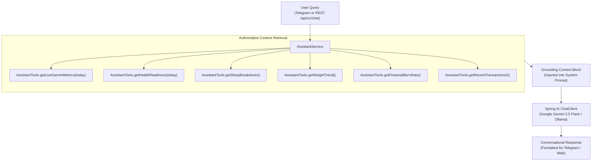

# 🤖 Life OS AI Assistant (Semantic Thought Partner)

The Life OS Assistant acts as the conversational and synthesis brain of PLOA. Rather than calculating numbers, it operates on top of pre-computed, deterministic indicators supplied through complete context grounding.

---

## 🏛️ Philosophy & Architecture

1. **Deterministic Numbers, Generative Synthesis**:
   - Math (Z-scores, rolling means, EMA weight, financial burn rates) is executed strictly in Java.
   - The LLM acts as an executive advisor, answering open questions, identifying cross-domain patterns (e.g., poor sleep correlated with elevated stress), and phrasing advice with personalized empathy.
2. **Dynamic Context Retrieval (`AssistantTools`)**:
   - Before answering the user, the assistant queries the live system state across health, sleep, weight, finances, and recent transactions.
   - Provides fresh grounding on every turn without latency or stale session state.
3. **Multi-Language & Tone Adaptability**:
   - Fluently speaks English, formal Vietnamese, and casual/informal Vietnamese (matching terms like "tao/mày" naturally when initiated by the user).
   - No rigid regex keyword filtering: questions phrased in any style or language are routed seamlessly.



---

## 🛠️ Grounding Tool Matrix (`AssistantTools`)

| Tool Function | Data Grounding Provided |
|---|---|
| `getLiveGarminMetrics(date)` | Today's Body Battery (current, high, low, charged, drained), Stress (avg, max, qualifier), Steps, Distance, Calories (active & total), Active time, Min/Max HR, SpO2, Respiration. |
| `getHealthReadiness(date)` | Readiness tier (`PRIME`/`NORMAL`/`FATIGUED`/`STRESSED`), HRV rMSSD vs 30-day baseline, RHR vs 30-day baseline, HRV/RHR Z-scores, sleep debt. |
| `getSleepBreakdown()` | Deep, REM, Light sleep duration, sleep score, restorative sleep percentage, 7-day average. |
| `getWeightTrend()` | Latest weight, 7-day EMA weight, distance to target goal, weekly rate of change. |
| `getFinancialBurnRate()` | MTD spend, Discretionary vs Fixed spend, remaining budget, daily burn rate, safe daily allowance, savings rate. |
| `getRecentTransactions(limit)`| Most recent expenditures with date, merchant, category, amount, and spend type. |

---

## ⚡ Technical Breakthrough: Gemini OpenAI Endpoint Compatibility

### Problem Encountered
When connecting Spring AI's OpenAI client to Google Gemini's OpenAI-compatible endpoint (`https://generativelanguage.googleapis.com/v1beta/openai/`), multi-turn client-side function calling fails with:
```
HTTP 400 - thought_signature missing in extra_content
```
Gemini strictly demands an opaque `thought_signature` token passed between tool-call turns that standard Spring AI OpenAI clients strip.

### Architectural Solution
Instead of relying on fragile client-side tool loops:
1. `AssistantService` calls `AssistantTools` synchronously in Java before generating the response.
2. The complete, structured snapshot of health, recovery, sleep, weight, and financial pacing is injected directly into the prompt context.
3. The LLM receives 100% authoritative data on turn 1 and answers freely with zero extra round-trips and zero 400 errors.

---

## 🌅 Daily Morning Briefing (07:30 AM)

The assistant orchestrates a proactive daily morning briefing pushed directly to Telegram:
- **Physical Readiness**: Interprets HRV Z-score and sleep debt to advise on training intensity for the day.
- **Body Composition**: Reports 7-day EMA weight smoothing trend.
- **Financial Pacing**: Reminds user of remaining days and safe daily allowance.
- **Narrative Delivery**: Keeps briefing punchy (< 200 words) and actionable.
- Can be previewed via `GET /api/v1/briefing/preview` or triggered on-demand via `/briefing` in Telegram.

---

## 📡 REST API Reference

| Method | Endpoint | Description | Payload / Query |
|---|---|---|---|
| `POST` | `/api/v1/chat` | Send a conversational message to the assistant. | `{"message": "Hôm nay tao có nên tập nặng không?"}` |
| `GET` | `/api/v1/chat` | Quick browser-accessible chat query. | `?q=how+is+my+body+battery+today` |
| `GET` | `/api/v1/briefing/preview` | Preview today's AI-generated morning briefing. | None |
| `POST` | `/api/v1/briefing/trigger` | Trigger immediate generation and Telegram push. | None |
