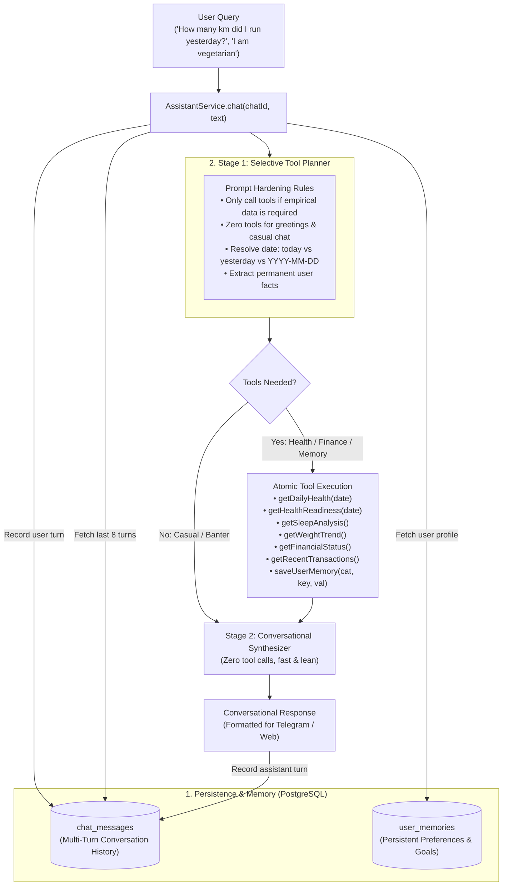

# 🤖 Life OS AI Assistant (Semantic Thought Partner & Memory)

The Life OS Assistant serves as the conversational intelligence of PLOA. It operates on an **Agentic, Selective Tool-Calling Architecture** coupled with **Multi-Turn Chat Memory** and a **Persistent Long-Term User Memory Store**.

---

## 🏛️ Architecture & Two-Stage Selective Execution

Rather than blindly stuffing a monolithic JSON of all biometrics, transactions, and baselines into every prompt, PLOA utilizes a **Two-Stage Selective Tool Planner**:

---

## 🛠️ Exclusive Atomic Tool Matrix

Every tool follows the **Single Responsibility Principle (SRP)**. Tools return dedicated, clean summary DTOs without massive raw payloads, preventing context clutter:

| Tool Name | Parameters | Scope & Responsibilities |
|---|---|---|
| `syncGarminData` | None | **Live Action Tool**: Triggers immediate on-demand synchronization with Garmin Connect via the sidecar (:8081/pull) and returns up-to-the-second biometrics. |
| `getDailyHealth` | `date` (`"today"`, `"yesterday"`, or `"YYYY-MM-DD"`) | Retrieves physical biometrics for the target date: steps, distance, active kcal, total kcal, active minutes, Body Battery (current, high, low), stress scores, resting HR, min/max HR, and SpO2. |
| `getHealthReadiness` | `date` (`"today"`, `"yesterday"`, or `"YYYY-MM-DD"`) | Evaluates recovery readiness: overnight HRV (rMSSD), 30-day baseline Z-scores, recovery level (`PRIME`, `NORMAL`, `FATIGUED`, `STRESSED`), and sleep debt. |
| `getSleepAnalysis` | None | Retrieves sleep stage breakdown (deep, light, REM, total) and 7-day sleep duration trend. |
| `getWeightTrend` | None | Retrieves latest body weight, 7-day Exponential Moving Average (EMA) smoothed weight, delta to goal, and weekly rate of change. |
| `getFinancialStatus` | None | Retrieves month-to-date budget pacing: monthly budget, total spend, discretionary vs fixed split, remaining budget, daily burn rate, and safe daily allowance. |
| `getRecentTransactions` | `limit` (int, default 5) | Retrieves the most recent individual logged expenditures. |
| `getPendingTransactions` | None | Retrieves unconfirmed or pending draft transactions awaiting user confirmation or recently modified via receipt OCR. |
| `getUserProfile` | None | Retrieves all persistent user preferences, dietary restrictions, and personal goals. |
| `saveUserMemory` | `category`, `key`, `value` | **Write Tool**: Automatically persists a user goal, habit, or preference to PostgreSQL (`user_memories`). |

---

## 🛡️ Prompt Hardening: Preventing Tool Abuse

To prevent hallucinations, over-fetching, and redundant calls, the Planner executes under strict system constraints:
1. **Zero-Tool Invocations**: Casual banter, greetings, opinions, or general knowledge (`"Hello"`, `"How are you"`, `"Tips for good sleep"`) execute with **zero tool calls** (`tools: []`).
2. **Deterministic Date Resolution**:
   - Inquiries about past activity (*"yesterday"*, *"last night"*) resolve to `date: "yesterday"`, retrieving finalized past-day metrics.
   - Inquiries about current progress resolve to `date: "today"`.
   - Inquiries referencing calendar dates resolve to `YYYY-MM-DD`.
3. **Cross-Domain Separation**: Financial questions never query health tools; workout questions never query financial ledgers.
4. **Persistent Memory Gate (`saveUserMemory`)**:
   - Explicit persona, tone, nickname, language, or pronoun rules (e.g. *"use informal pronouns in Vietnamese"*, *"call me Boss"*, *"speak casually"*).
   - Long-term dietary habits and constraints (e.g. *"I am vegetarian"*, *"lactose intolerant"*).
   - Athletic & fitness goals (e.g. *"Target 21km half-marathon in December"*).
   - Monthly financial budgets or savings rules.
   - General instructions beginning with *"From now on..."*, *"Always remember that..."*, or *"Note that..."*.

---

## ⏰ Real-Time Temporal Context Awareness (`TemporalContext`)

Every model request is automatically enriched with real-time temporal grounding:
- **Full ISO Timestamp**: `2026-10-20T08:48:00+07:00`
- **Current Date & Day of Week**: `2026-10-20 (Tuesday)`
- **Current Time & Period**: `08:48:00 (Morning / Noon / Afternoon / Evening / Night)`
- **Timezone**: `Asia/Ho_Chi_Minh (UTC+07:00)`

### Conversational Alignment & Behavioral Benefits
1. **Time-Aware Tone & Guidance**: The Assistant aligns greetings and advice with the exact time of day (e.g., suggesting wind-down routines at night vs morning workout readiness).
2. **Relative Time Precision**: Queries referencing *"today"*, *"yesterday"*, *"last night"*, *"this morning"*, or *"earlier"* are resolved against real-time clock telemetry.
3. **Tool Execution Accuracy**: The Tool Planner evaluates whether queries refer to completed past events or current ongoing progress.

---

## 🧠 Memory Systems

### 1. Short-Term Multi-Turn Chat Memory
- Table: `chat_messages` (`chat_id`, `role`, `content`, `created_at`).
- Provides a sliding window of the last 8 conversation turns.
- Enables natural follow-up dialogue:
  - User: *"How many steps did I take yesterday?"* $\rightarrow$ Model answers for yesterday (4,363 steps).
  - User: *"What about today?"* $\rightarrow$ Model understands context and answers for today.
- Reset anytime via `/new` or `DELETE /api/v1/memory/history?chatId=...`.

### 2. Long-Term Personalization Memory
- Table: `user_memories` (`category`, `memory_key`, `memory_value`, `source`, `created_at`, `updated_at`).
- Categories: `PREFERENCE`, `PERSONA`, `FITNESS`, `DIET`, `FINANCE`, `LIFESTYLE`, `GOAL`, `GENERAL`.
- **Dual Write Path**:
  - **Explicit User API**: `POST /api/v1/memory`
  - **Conversational Memory**: Model autonomously extracts and saves facts using `saveUserMemory`.
- **Continuous Personalization**: Profile memories are automatically grounded into every prompt, and the model is strictly instructed to obey saved persona, tone, and pronoun preferences.

---

## 📡 REST API Reference

| Method | Endpoint | Description | Query / Body |
|---|---|---|---|
| `POST` | `/api/v1/chat` | Send a message to the assistant with session tracking. | `{"message": "...", "chatId": "session-123"}` |
| `GET` | `/api/v1/chat` | Browser-friendly GET chat query. | `?q=...&chatId=...` |
| `GET` | `/api/v1/memory` | Retrieve all stored user memories/preferences. | `?category=FITNESS` (optional) |
| `POST` | `/api/v1/memory` | Explicitly record a user preference. | `{"category": "FITNESS", "key": "goal", "value": "21km"}` |
| `DELETE` | `/api/v1/memory/{id}` | Delete a specific memory item by UUID. | None |
| `DELETE` | `/api/v1/memory/history` | Clear conversation history for a specific chat ID. | `?chatId=...` |
| `GET` | `/api/v1/health/daily` | Retrieve biometrics for a specific date. | `?date=today` or `?date=yesterday` or `?date=YYYY-MM-DD` |
