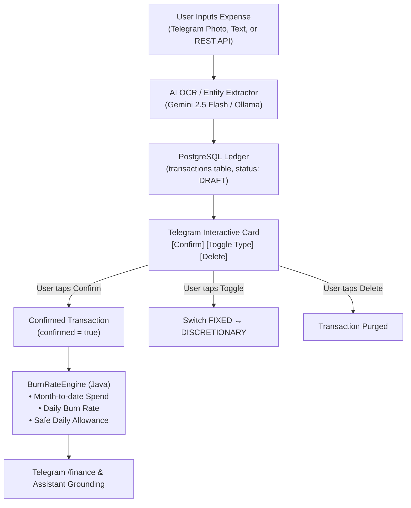

# 💰 Personal Finance Ledger & Burn Rate Analytics

The Finance subsystem in PLOA provides frictionless expense logging and deterministic budget pacing. It replaces traditional manual spreadsheet tracking by combining Vision OCR with mathematical burn rate tracking.

---

## 🏗️ Architecture & Ledger Flow

---

## 📋 Data Model (`Transaction` Entity)

Transactions are persisted in PostgreSQL with the following schema:

| Field | Type | Description |
|---|---|---|
| `id` | UUID (PK) | Globally unique identifier. |
| `amount` | BigDecimal | Monetary amount in configured currency (default VND). |
| `currency` | String | ISO 4217 currency code (e.g., `VND`, `USD`). |
| `spend_type` | Enum | `FIXED` (rent, bills, utilities) or `DISCRETIONARY` (dining out, entertainment, shopping). |
| `category` | String | Extracted category (Food & Dining, Transport, Groceries, Utilities, Healthcare, etc.). |
| `merchant` | String | Extracted or entered business name (e.g., Highlands Coffee, Grab, Shopee). |
| `note` | String | Additional context or memo. |
| `tx_date` | LocalDate | Date of expenditure. |
| `tx_timestamp` | OffsetDateTime | Event timestamp printed on the bill (falls back to upload time). |
| `invoice_number` | String | Printed invoice code, order ID, or banking transfer reference. |
| `image_sha256` | String | SHA-256 hash of the receipt image for exact-match deduplication. |
| `duplicate_warning` | String | Warning message if suspected duplicate detected; null if unique. |
| `receipt_image_url`| String | Optional link to stored receipt image. |
| `confirmed` | Boolean | `false` when held in draft state awaiting user validation; `true` once approved. |
| `telegram_message_id`| Long | Links the transaction to the interactive Telegram message for in-place edits. |

---

## 🧮 Deterministic Financial Engine (`BurnRateEngine`)

The financial engine guarantees mathematical integrity without generative hallucinations.

### 1. Month-to-Date Aggregation
- Pulls all **confirmed** transactions for the active calendar month.
- Aggregates:
  - $\text{MTD Total Spend} = \sum \text{All Confirmed Spend}$
  - $\text{MTD Discretionary} = \sum \text{Discretionary Spend}$
  - $\text{MTD Fixed} = \sum \text{Fixed Spend}$
  - $\text{Remaining Budget} = \text{Monthly Budget} - \text{MTD Total Spend}$

### 2. Pacing & Safe Daily Allowance
- Calculates elapsed days and remaining days in the active month:
  $$\text{Days Elapsed} = \text{Current Day} - 1 \quad (\text{min } 1)$$
  $$\text{Days Remaining} = \text{Days in Month} - \text{Days Elapsed}$$
- **Daily Burn Rate**:
  $$\text{Daily Burn Rate} = \frac{\text{MTD Total Spend}}{\text{Days Elapsed}}$$
- **Safe Daily Allowance**:
  $$\text{Safe Daily Allowance} = \frac{\max(0, \text{Remaining Budget})}{\max(1, \text{Days Remaining})}$$
- **Projected Savings Rate**:
  $$\text{Savings Rate} = \frac{\text{Monthly Budget} - \text{MTD Total Spend}}{\text{Monthly Budget}} \times 100\%$$

---

## 🎮 Interactive Telegram Workflow

1. **Capture & Deduplication**:
   - Sending a receipt photo, document, or text (`50k coffee`) triggers instant OCR extraction.
   - Evaluates multi-tier deduplication (exact image SHA-256, invoice number, and fuzzy amount+date+merchant match).
   - If a potential duplicate is detected, a prominent warning is rendered on the draft card with a `[✅ Confirm Anyway]` override button.
2. **Review Keyboard**:
   - `[✅ Confirm]` (or `[✅ Confirm Anyway]`): Commits the transaction to the burn rate engine.
   - `[✏️ Edit]`: Prompts user for natural language corrections.
   - `[🔄 Toggle Type]`: In-place toggle between `DISCRETIONARY` and `FIXED`.
   - `[🗑️ Delete]`: Discards the transaction and logs the discard event.
3. **Conversational In-Place Refinement**:
   - Users can swipe and directly reply to the transaction card with corrections (e.g. *"Amount is 45k, not 55k"*, *"Merchant is Starbucks"*).
   - The AI refiner patches the draft transaction and edits the card in place without creating clutter.
4. **Pacing Inquiry**: Sending `/finance` outputs the current pacing overview:
   - Days elapsed / remaining
   - MTD Total, Fixed, and Discretionary spend
   - Safe daily allowance vs current daily burn rate

---

## 📡 REST API Reference

| Method | Endpoint | Description | Query / Payload |
|---|---|---|---|
| `GET` | `/api/v1/finance/burn-rate` | Retrieve MTD burn rate, remaining budget, and safe daily allowance. | None |
| `GET` | `/api/v1/finance/transactions` | List confirmed and draft transactions for the current month. | `?limit=30` |
| `POST` | `/api/v1/finance/transactions` | Manually record a transaction. | Request Body (`Transaction` JSON) |
| `POST` | `/api/v1/finance/ocr` | Upload a receipt or bank transfer screenshot to extract and record. | Multipart form `file=@receipt.jpg` |
| `GET` | `/api/v1/finance/ocr/metrics` | Retrieve OCR stability KPIs (acceptance rate, edit rate, discard rate, confidence). | None |
