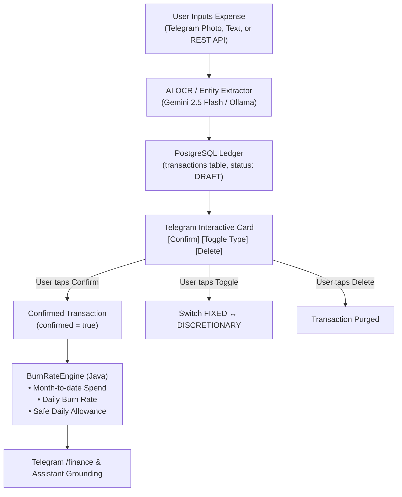

# 💰 Personal Finance Ledger & Burn Rate Analytics

The Finance subsystem in PLOA provides frictionless expense logging and deterministic budget pacing. It replaces traditional manual spreadsheet tracking by combining Vision OCR with mathematical burn rate tracking.

---

## 🏗️ Architecture & Ledger Flow

---

## 📋 Data Model (`Transaction` Entity)

Transactions are persisted in PostgreSQL with the following schema:

| Field | Type | Description |
|---|---|---|
| `id` | UUID (PK) | Globally unique identifier. |
| `amount` | BigDecimal | Monetary amount in configured currency (default VND). |
| `currency` | String | ISO 4217 currency code (e.g., `VND`, `USD`). |
| `spend_type` | Enum | `FIXED` (rent, bills, utilities) or `DISCRETIONARY` (dining out, entertainment, shopping). |
| `category` | String | Extracted category (Food & Dining, Transport, Groceries, Utilities, Healthcare, etc.). |
| `merchant` | String | Extracted or entered business name (e.g., Highlands Coffee, Grab, Shopee). |
| `note` | String | Additional context or memo. |
| `tx_date` | LocalDate | Date of expenditure. |
| `receipt_image_url`| String | Optional link to stored receipt image. |
| `confirmed` | Boolean | `false` when held in draft state awaiting user validation; `true` once approved. |
| `telegram_message_id`| Long | Links the transaction to the interactive Telegram message for in-place edits. |

---

## 🧮 Deterministic Financial Engine (`BurnRateEngine`)

The financial engine guarantees mathematical integrity without generative hallucinations.

### 1. Month-to-Date Aggregation
- Pulls all **confirmed** transactions for the active calendar month.
- Aggregates:
  - $\text{MTD Total Spend} = \sum \text{All Confirmed Spend}$
  - $\text{MTD Discretionary} = \sum \text{Discretionary Spend}$
  - $\text{MTD Fixed} = \sum \text{Fixed Spend}$
  - $\text{Remaining Budget} = \text{Monthly Budget} - \text{MTD Total Spend}$

### 2. Pacing & Safe Daily Allowance
- Calculates elapsed days and remaining days in the active month:
  $$\text{Days Elapsed} = \text{Current Day} - 1 \quad (\text{min } 1)$$
  $$\text{Days Remaining} = \text{Days in Month} - \text{Days Elapsed}$$
- **Daily Burn Rate**:
  $$\text{Daily Burn Rate} = \frac{\text{MTD Total Spend}}{\text{Days Elapsed}}$$
- **Safe Daily Allowance**:
  $$\text{Safe Daily Allowance} = \frac{\max(0, \text{Remaining Budget})}{\max(1, \text{Days Remaining})}$$
- **Projected Savings Rate**:
  $$\text{Savings Rate} = \frac{\text{Monthly Budget} - \text{MTD Total Spend}}{\text{Monthly Budget}} \times 100\%$$

---

## 🎮 Interactive Telegram Workflow

1. **Capture**: Sending a photo of a receipt or typing `50k coffee` triggers instant extraction and generates a draft transaction.
2. **Review Keyboard**:
   - `[✅ Confirm]`: Sets `confirmed = true`. The transaction is immediately included in the burn rate engine.
   - `[🔄 Toggle Type]`: Toggles spend type between `DISCRETIONARY` and `FIXED` in place.
   - `[🗑️ Delete]`: Deletes the draft from PostgreSQL.
3. **Pacing Inquiry**: Sending `/finance` outputs the current pacing overview:
   - Days elapsed / remaining
   - MTD Total, Fixed, and Discretionary spend
   - Safe daily allowance vs current daily burn rate

---

## 📡 REST API Reference

| Method | Endpoint | Description | Query / Payload |
|---|---|---|---|
| `GET` | `/api/v1/finance/burn-rate` | Retrieve MTD burn rate, remaining budget, and safe daily allowance. | None |
| `GET` | `/api/v1/finance/transactions` | List confirmed and draft transactions for the current month. | `?limit=30` |
| `POST` | `/api/v1/finance/transactions` | Manually record a transaction. | Request Body (`Transaction` JSON) |
| `POST` | `/api/v1/finance/ocr` | Upload a receipt or bank transfer screenshot to extract and record. | Multipart form `file=@receipt.jpg` |
