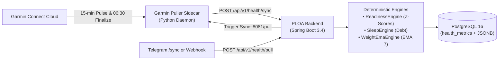

# 🏥 Physical Health & Recovery Tracking

The Health & Recovery subsystem in PLOA is designed to passively ingest, store, model, and analyze real-time biometrics from Garmin Connect. It enforces a strict separation between **deterministic mathematical modeling** in Java and **generative advisory** in the AI Assistant.

---

## 🏗️ Architecture & Data Ingestion Flow

1. **Sidecar Ingestion Daemon (`ploa-garmin-puller`)**:
   - Built on `garminconnect` and `garth`.
   - Session tokens are cached persistently in Docker volume (`/root/.garminconnect`) to prevent authentication rate limits (HTTP 429).
   - **Morning Finalization (06:30)**: Automatically syncs **yesterday** (to lock in final daily step totals and active calorie expenditure) and **today** (to ingest overnight sleep stages, HRV rMSSD, and morning resting HR).
   - **Daytime Pulse (Every 15 min, 06:00 - 23:00)**: Periodically pulls current-day metrics so that Body Battery, stress, and activity remain fresh throughout the day.
   - **Internal HTTP Server (`:8081/pull`)**: Exposes an on-demand webhook so users can trigger an instant pull anytime via Telegram (`/sync`) or REST (`POST /api/v1/health/pull`).

---

## 📊 Biometrics Telemetry Suite

Data is stored in the `health_metrics` table with complete columns and raw telemetry backup:

| Metric Category | Fields Ingested | Description |
|---|---|---|
| **Body Battery** | `body_battery_current`, `body_battery_highest`, `body_battery_lowest`, `body_battery_charged`, `body_battery_drained` | Real-time energy reserve (0-100), daily peak, valley, and charge/drain dynamics. |
| **Stress & Recovery** | `stress_avg`, `stress_max`, `stress_qualifier` | All-day sympathetic nervous system load (0-100) and qualifier (`calm`, `balanced`, `stressful`). |
| **Cardiovascular** | `rhr`, `min_hr`, `max_hr`, `hrv_rmssd` | Resting Heart Rate, daily HR extremes, and 7-day overnight HRV (root mean square of successive differences). |
| **Respiratory & SpO2**| `respiration_avg`, `spo2_avg` | Average breaths per minute and blood oxygen saturation. |
| **Sleep Architecture**| `sleep_score`, `sleep_total_min`, `sleep_deep_min`, `sleep_rem_min`, `sleep_light_min` | Overall sleep score (0-100), total duration, and restorative phase breakdown. |
| **Energy & Movement** | `steps`, `distance_meters`, `active_kcal`, `total_kcal`, `active_time_min`, `moderate_min`, `vigorous_min` | Daily step count, distance traveled, caloric burn (active vs total), and intensity minutes. |
| **Raw Telemetry** | `raw_data_jsonb` (JSONB) | Complete raw response payload from Garmin Connect API for ad-hoc analytical queries and future schema expansions. |

---

## 🧮 Deterministic Java Engines

All quantitative indicators are calculated strictly in Java. The LLM is never allowed to calculate or modify these scores.

### 1. `ReadinessEngine` (30-day Rolling Z-Scores)
- Evaluates the user's recovery state by comparing today's overnight HRV (`hrvRmssd`) and Resting Heart Rate (`rhr`) against a 30-day rolling baseline ($\mu$ and $\sigma$):
  $$\text{Z-Score} = \frac{x - \mu_{30d}}{\sigma_{30d}}$$
- **Readiness Classification**:
  - `PRIME`: $\text{HRV}_Z \ge +0.5$ and $\text{RHR}_Z \le 0.0$ (High parasympathetic tone, primed for strain).
  - `NORMAL`: $-1.0 \le \text{HRV}_Z \le +1.5$ and $\text{RHR}_Z \le +1.0$ (Standard recovery).
  - `FATIGUED`: $\text{HRV}_Z < -1.0$ and $\text{RHR}_Z \le +1.0$ (Depleted autonomic capacity).
  - `STRESSED`: $\text{RHR}_Z > +1.0$ or ($\text{HRV}_Z < -1.5$ and $\text{RHR}_Z > +0.5$) (Elevated sympathetic tone / systemic stress).

### 2. `SleepEngine` (Cumulative Sleep Debt)
- Compares sleep duration against the user's configured nightly target (e.g., 7.5 hours / 450 minutes).
- Calculates the **Restorative Sleep Ratio**:
  $$\text{Restorative Ratio} = \frac{\text{Deep Sleep Min} + \text{REM Sleep Min}}{\text{Total Sleep Min}}$$
- Tracks accumulated sleep debt over rolling 7-day windows.

### 3. `WeightEmaEngine` (7-day Exponential Moving Average)
- Eliminates short-term water weight volatility using an Exponential Moving Average:
  $$\alpha = \frac{2}{N + 1} = \frac{2}{7 + 1} = 0.25$$
  $$\text{EMA}_{\text{today}} = (\text{Weight}_{\text{today}} \times \alpha) + (\text{EMA}_{\text{yesterday}} \times (1 - \alpha))$$
- Calculates distance to target weight and weekly rate of change (kg/week).

---

## 📡 REST API Reference

All endpoints accept authentication via `X-API-Key: <key>`, `Authorization: Bearer <key>`, or `?apiKey=<key>`.

| Method | Endpoint | Description | Query Parameters |
|---|---|---|---|
| `GET` | `/api/v1/health/daily` | Retrieve biometrics for a specific date (`today`, `yesterday`, or `YYYY-MM-DD`). | `?date=today` or `?date=yesterday` or `?date=YYYY-MM-DD` |
| `GET` | `/api/v1/health/today` | Return comprehensive live biometrics for today (Body Battery, Stress, Steps, Calories, etc.). | None |
| `POST` | `/api/v1/health/pull` | Trigger immediate on-demand synchronization from the Garmin sidecar. | None |
| `POST` | `/api/v1/health/sync` | Ingest daily physiological metrics (idempotent upsert by date). | Request Body (`HealthSyncRequest`) |
| `GET` | `/api/v1/health/readiness` | Compute 30-day rolling Z-scores, sleep debt, and recovery state. | `?date=today` or `?date=YYYY-MM-DD` |
| `GET` | `/api/v1/health/weight` | Compute 7-day EMA weight trend and delta to target goal. | None |
| `GET` | `/api/v1/health/sleep` | Retrieve sleep breakdown (deep, light, REM) and 7-day trend. | None |
