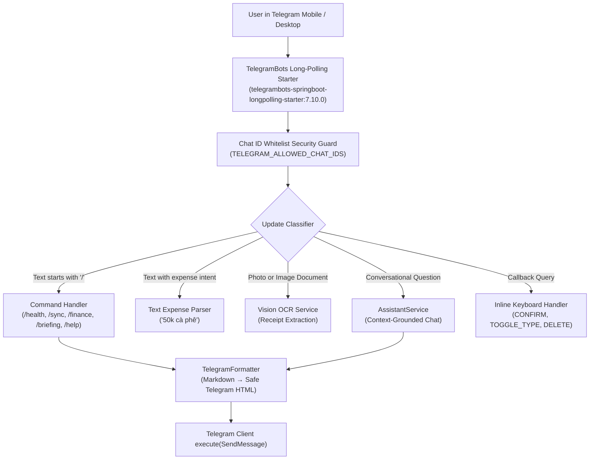

# 📱 Telegram Bot Gateway (`@PL0A_bot`)

The Telegram Bot serves as the primary conversational, input, and notification touchpoint for PLOA. It provides a frictionless mobile UI without requiring custom app installations.

---

## 🏛️ Architecture & Event Lifecycle



---

## 🔒 Security & Access Control

- **Chat ID Whitelist**: Configured via `TELEGRAM_ALLOWED_CHAT_IDS` in `.env`.
- Any message or callback originating from an unauthorized chat ID is immediately ignored, preventing unauthorized access or data exfiltration on public bot handles.

---

## ⌨️ Command Registry

| Command | Handler Action | Output |
|---|---|---|
| `/health` | Retrieves today's readiness, HRV/RHR Z-scores, sleep debt, and 7-day weight EMA. | Structured Health & Readiness card. |
| `/sync` | Triggers immediate on-demand pull from `http://garmin-puller:8081/pull`. | Live Body Battery, Stress, Steps, Active vs Total Calories, Active Time, and HR extremes. |
| `/finance` | Retrieves MTD spend, fixed vs discretionary split, daily burn rate, and safe daily allowance. | Financial pacing summary. |
| `/briefing` | On-demand trigger for the AI morning briefing synthesizer. | Executive daily briefing text. |
| `/help` | Displays command cheat-sheet and usage tips. | Help manual. |

---

## 📸 Interactive Inline Keyboards (Receipt Confirmation)

Whenever a photo or quick expense is captured, the bot responds with an interactive message containing three callback buttons:
```
📋 Transaction Captured
💰 Amount: 55,000 VND
🏷️ Category: Food & Dining (DISCRETIONARY)
🏪 Merchant: Highlands Coffee
📅 Date: 2026-10-19
📝 Note: Cà phê sữa đá size L

[✅ Confirm]  [🔄 Toggle Type]  [🗑️ Delete]
```

- `CONFIRM:<id>`: Commits the draft into the ledger (`confirmed = true`). Edits the card to `✅ Transaction confirmed!`.
- `TOGGLE_TYPE:<id>`: Toggles spend type between `FIXED` and `DISCRETIONARY` in-place, updating the message view without spamming new messages.
- `DELETE:<id>`: Deletes the transaction from PostgreSQL and edits the card to `🗑️ Transaction deleted.`.

---

## 🎨 Safe Formatting Engine (`TelegramFormatter`)

### The Markdown Entity Parse Error Issue
Telegram's legacy `Markdown` parse mode is notoriously fragile:
- Unpaired underscores inside words (such as `body_battery_current` or `z_score`) are treated as open italics tags.
- Bullet points starting with `* ` or standard LLM bold `**bold**` cause Telegram to fail with:
  ```
  [400] Bad Request: can't parse entities: Can't find end of the entity starting at byte offset XXX
  ```

### The Solution: `TelegramFormatter.markdownToHtml`
PLOA includes a dedicated formatter in `com.ploa.bot.TelegramFormatter`:
1. **HTML Escaping**: Automatically escapes `&`, `<`, and `>` to `&amp;`, `&lt;`, and `&gt;`.
2. **Code Blocks & Inline Code**: Converts ```` ```code``` ```` to `<pre>code</pre>` and `` `code` `` to `<code>code</code>`.
3. **Headers**: Converts `### Header` to `<b>Header</b>`.
4. **Bold**: Converts `**bold**` to `<b>bold</b>`.
5. **Bullets**: Converts `* item` or `- item` at start of line to bullet character `• item`.
6. **Italics**: Converts `_italic_` and `*italic*` with word boundaries to `<i>italic</i>`. Underscores within words (snake_case) remain untouched.
7. **Robust Fallback**: If Telegram's HTML parser ever encounters an issue, the bot gracefully falls back to sending plain unformatted text without crashing or spamming `WARN` logs.
